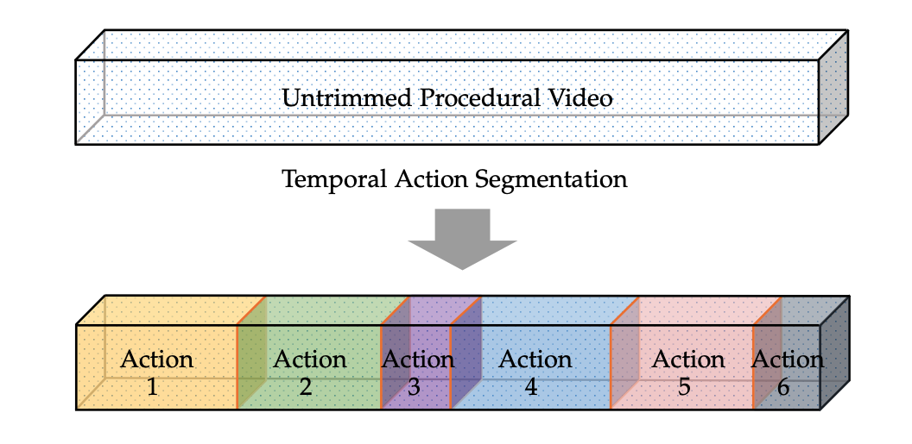

<div align="center">

# Awesome Temporal Action Segmentation


**A curated list of temporal action segmentation (TAS) papers, datasets, metrics and tools — updated through 2026.**

[](https://github.com/sindresorhus/awesome)
[](#)
[](#-paper-list)
[](https://github.com/nus-cvml/awesome-temporal-action-segmentation/pulls)
[](#)

⭐ **Please leave a STAR if you like this project!** ⭐

</div>

> **Legend:** 📄 paper · 💻 code · Click a paper title to expand its abstract where available.

## 📚 Table of Contents

- [The Task](#-the-task)
- [Surveys & Overviews](#-surveys--overviews)
- [Datasets](#-datasets)
- [Evaluation Measures](#-evaluation-measures)
- [Where Things Stand](#-where-things-stand-fully-supervised-i3d-features)
- [Paper List](#-paper-list)
  - [Fully-Supervised](#fully-supervised) · [Weakly-Supervised](#weakly-supervised) · [Unsupervised](#unsupervised) · [Semi-Supervised](#semi-supervised) · [Online](#online) · [Continual](#continual)
  - [Active Learning & Dataset Condensation](#active-learning--dataset-condensation) · [Few-Shot, Open-Vocabulary & Zero-Shot](#few-shot-open-vocabulary--zero-shot) · [Skeleton-Based](#skeleton-based-temporal-action-segmentation)
- [Related Lists](#-related-lists)
- [Contributing](#-contributing)
- [Citation](#-citation)

## 🎯 The Task

Temporal Action Segmentation takes as input an untrimmed video, partitions it along the temporal axis into segments, and assigns an action label to every frame. It differs from temporal action *detection/localization* (sparse instances in mostly-background video) in that procedural videos are densely labelled with ordered, variable-length actions.

<p align="center"></p>

## 📖 Surveys & Overviews

| Resource | Type | Venue |
|---|---|---|
| [Temporal Action Segmentation: An Analysis of Modern Techniques](https://arxiv.org/pdf/2210.10352.pdf) — Guodong Ding, Fadime Sener, and Angela Yao | Survey | TPAMI 2023 |
| [ATLAS tutorial](https://nus-cvml.github.io/atlas-eccv22) — in conjunction with ECCV 2022 | Tutorial | ECCV 2022 |
| [Action Recognition: A Comprehensive Survey of Tasks, Methods, and Challenges](https://www.sciencedirect.com/science/article/pii/S2405959525001869) — covers TAS alongside TAL, OAD and anticipation | Survey | 2025 |

## 🗂️ Datasets

| Dataset | Year | View | Videos | Actions | Typical use | Paper |
|---|---|---|---|---|---|---|
| **Breakfast** | 2014 | 3rd person, multi-cam | 1,712 | 48 | Fully / weakly / unsup. | [Kuehne et al., CVPR 2014](https://openaccess.thecvf.com/content_cvpr_2014/papers/Kuehne_The_Language_of_2014_CVPR_paper.pdf) |
| **GTEA** | 2011 | Egocentric | 28 | 11 | Fully / timestamp | [Fathi et al., CVPR 2011](https://arxiv.org/pdf/2102.08065.pdf) |
| **50Salads** | 2013 | Top-down | 50 | 17–19 | Fully / timestamp / unsup. | [Stein & McKenna, UbiComp 2013](https://doi.org/10.1145/2493432.2493482) |
| **YouTube Instructional** | 2016 | Web | 150 | 46 | Unsupervised | [Alayrac et al., CVPR 2016](https://doi.org/10.1109/CVPR.2016.495) |
| **Assembly101** | 2022 | Multi-view ego+exo | 4,321 | 202 | Fully / cross-view | [Sener et al., CVPR 2022](https://openaccess.thecvf.com/content/CVPR2022/papers/Sener_Assembly101_A_Large-Scale_Multi-View_Video_Dataset_for_Understanding_Procedural_Activities_CVPR_2022_paper.pdf) |
| **Desktop Assembly** | 2022 | Fixed | 76 | 22 | Unsupervised | [Kumar et al., CVPR 2022](https://openaccess.thecvf.com/content/CVPR2022/papers/Kumar_Unsupervised_Action_Segmentation_by_Joint_Representation_Learning_and_Online_Clustering_CVPR_2022_paper.pdf) |
| **EgoProceL** | 2022 | Egocentric | 1,055 | 130 | Fully / procedure learning | [Bansal et al., ECCV 2022](https://www.ecva.net/papers/eccv_2022/papers_ECCV/papers/136730656.pdf) |
| **CrossTask** | 2019 | Web | 4,700 | 18 tasks | Weak / active / few-shot | [Zhukov et al., CVPR 2019](https://openaccess.thecvf.com/content_CVPR_2019/papers/Zhukov_Cross-Task_Weakly_Supervised_Learning_From_Instructional_Videos_CVPR_2019_paper.pdf) |

🤗 Pre-extracted I3D features for the three classic benchmarks are hosted on Hugging Face: [gtea](https://huggingface.co/datasets/dinggd/gtea) · [50salads](https://huggingface.co/datasets/dinggd/50salads) · [breakfast](https://huggingface.co/datasets/dinggd/breakfast). Do let us know if there are any IP issues regarding hosting these datasets on Hugging Face!

## 📏 Evaluation Measures

### Acc

Accuracy or MoF (mean over frames) are an per-frame accuracy measure that calculates the ratio of frames that are correctly recognized by the temporal action model:

$\text{Acc}=\frac{\text{number of correct frames}}{\text{number of all frames}}$

### F1 score

The F1-score, or F1@$\tau$ compares the Intersection over Union (IoU) of each segment with respect to the corre- sponding ground truth based on some threshold $\tau/100$. $\tau$ are set to $\{10,25,50\}$. A segment is considered a true positive if its score with respect to the ground truth exceeds the threshold. If there is more than one correct segment within the span of a single ground truth action, then only one is marked as a true positive and the others are marked as false positives.

$\text{F1} = 2 \cdot \frac{\text{precision}\times \text{recall}}{\text{precision} +\text{recall}}$.

### Edit score

The Edit Score is computed using the Levenshtein distance $e$, which quantifies how similar two sequences are to each other by counting the minimum number of operations required to convert one (segment) string into another.

$\text{Edit} = \left(1-\frac{e(X,Y)}{\text{max}(|X|,|Y|)} \right)\cdot 100$

## 📈 Where Things Stand (fully-supervised, I3D features)

Representative numbers on the three classic benchmarks, as reported in the DSA_Net paper (arXiv 2025). Use them as a quick orientation, not as a leaderboard — protocols and features vary across papers.

| Method | Venue | 50Salads Acc / Edit / F1@50 | Breakfast Acc / Edit / F1@50 | GTEA Acc / Edit / F1@50 |
|---|---|---|---|---|
| MS-TCN++ | TPAMI 2020 | 83.7 / 74.3 / 70.1 | 67.6 / 64.9 / 45.9 | 80.1 / 83.5 / 76.0 |
| ASFormer | BMVC 2021 | 85.6 / 79.6 / 76.0 | 73.5 / 75.0 / 57.4 | 79.7 / 84.6 / 79.2 |
| DiffAct | ICCV 2023 | 88.9 / 85.0 / 83.7 | 76.4 / 78.4 / 64.6 | 82.2 / 89.6 / 84.7 |
| FACT | CVPR 2024 | — | 76.2 / 79.7 / 66.2 | 86.1 / 91.4 / 84.1 |
| DSA_Net | arXiv 2025 | 91.3 / 88.8 / 87.1 | 78.0 / 80.4 / 68.1 | 88.3 / 92.1 / 85.2 |

**Trends worth knowing (2024–2026):** diffusion/generative decoders (DiffAct → ActFusion, Difformer, EffiDiffAct), query/segment-level transformers (BaFormer, TQT, EAST), state-space / Mamba temporal encoders (ASMamba, DSA_Net), optimal-transport pseudo-labelling for unsupervised TAS (ASOT → CLOT, VASOT, HVQ, SpecT-OT, PEOT), and a growing focus on label efficiency (active learning, dataset condensation), cross-view / ego–exo transfer, and VLM-based open-vocabulary segmentation.

## 📝 Paper List

Papers from **2024–2026** are shown in full; earlier years are collapsed under each category.

### Fully-Supervised

<sub>57 papers · [back to top](#-table-of-contents)</sub>

#### 2026

| Paper | Authors | Venue | Links |
|---|---|---|---|
| Improving Temporal Action Segmentation via Constraint-Aware Decoding | Yeo Keat Ee … and Basura Fernando | **arXiv 2026** | [📄](https://arxiv.org/pdf/2605.10149) [💻](https://github.com/LUNAProject22/CAD) |
| LogFA: Efficient Feature-Space Data Augmentation for Egocentric Temporal Action Segmentation | Zijia Lu and Ehsan Elhamifar | **ECCV 2026** | [📄](https://eccv.ecva.net/virtual/2026/calendar) |
| Exocentric-to-Egocentric Adaptation for Temporal Action Segmentation with Unlabeled Synchronized Video Pairs | Camillo Quattrocchi … and Giovanni Maria Farinella | **IJCV 2026** | [📄](https://link.springer.com/article/10.1007/s11263-025-02675-1) [💻](https://github.com/fpv-iplab/synchronization-is-all-you-need) |
| Looking into the Unknown: Exploring Action Discovery for Segmentation of Known and Unknown Actions | Federico Spurio … and Juergen Gall | **CVIU 2026** | [📄](https://arxiv.org/pdf/2508.05529) |

#### 2025

| Paper | Authors | Venue | Links |
|---|---|---|---|
| Dual-Stream Alignment for Action Segmentation | Harshala Gammulle … and Simon Denman | **arXiv 2025** | [📄](https://arxiv.org/pdf/2510.07652) |
| End-to-End Action Segmentation Transformer | Tieqiao Wang and Sinisa Todorovic | **ICCVW 2025** | [📄](https://openaccess.thecvf.com/content/ICCV2025W/SVU/papers/Wang_End-to-End_Action_Segmentation_Transformer_ICCVW_2025_paper.pdf) |
| Difformer for Action Segmentation | Nicolas Aziere and Sinisa Todorovic | **ICCVW 2025** | [📄](https://openaccess.thecvf.com/content/ICCV2025W/SVU/papers/Aziere_Difformer_for_Action_Segmentation_ICCVW_2025_paper.pdf) |
| Towards Generalizing Temporal Action Segmentation to Unseen Views | Emad Bahrami … and Juergen Gall | **IJCV 2025** | [📄](https://link.springer.com/article/10.1007/s11263-025-02703-0) |
| Enhancing Temporal Action Segmentation with Large Language Models | Ren Sasage et al. | **2025** | [📄](https://www.researchgate.net/publication/395416903_Enhancing_Temporal_Action_Segmentation_with_Large_Language_Models) |

#### 2024

| Paper | Authors | Venue | Links |
|---|---|---|---|
| FACT: Frame-Action Cross-Attention Temporal Modeling for Efficient Fully-Supervised Action Segmentation | Zijia Lu and Ehsan Elhamifar | **CVPR 2024** | [📄](https://openaccess.thecvf.com/content/CVPR2024/papers/Lu_FACT_Frame-Action_Cross-Attention_Temporal_Modeling_for_Efficient_Action_Segmentation_CVPR_2024_paper.pdf) [💻](https://github.com/ZijiaLewisLu/CVPR2024-FACT) |
| ActFusion: a Unified Diffusion Model for Action Segmentation and Anticipation | Dayoung Gong, Suha Kwak, and Minsu Cho | **NeurIPS 2024** | [📄](https://arxiv.org/pdf/2412.04353) |
| Efficient Temporal Action Segmentation via Boundary-aware Query Voting | Peiyao Wang … and Haibin Ling | **NeurIPS 2024** | [📄](https://arxiv.org/abs/2405.15995) [💻](https://github.com/peiyao-w/BaFormer) |
| Synchronization is All You Need: Exocentric-to-Egocentric Transfer for Temporal Action Segmentation with Unlabeled Synchronized Video Pairs | Camillo Quattrocchi … and Giovanni Maria Farinella | **ECCV 2024** | [📄](https://arxiv.org/pdf/2312.02638) [💻](https://github.com/fpv-iplab/synchronization-is-all-you-need) |
| Faster Diffusion Action Segmentation | Shuaibing Wang … and Lihua Zhang | **arXiv 2024** | [📄](https://arxiv.org/pdf/2408.02024) |
| Video Mamba Suite: State Space Model as a Versatile Alternative for Video Understanding (ASMamba) | Guo Chen … and Limin Wang | **arXiv 2024** | [📄](https://arxiv.org/pdf/2403.09626) [💻](https://github.com/OpenGVLab/video-mamba-suite) |

<details>
<summary><b>Earlier work (2016–2023, 42 papers)</b></summary>


#### 2023

| Paper | Authors | Venue | Links |
|---|---|---|---|
| Temporal Segment Transformer for Action Segmentation | Zhichao Liu et al. | **arXiv 2023** | [📄](https://arxiv.org/pdf/2302.13074) |
| CASR: Refining Action Segmentation via Marginalizing Frame-level Causal Relationships | See arXiv for author list | **arXiv 2023** | [📄](https://arxiv.org/pdf/2311.12401) |
| Dir-AS: Decoupling Individual Identification and Temporal Reasoning for Action Segmentation | Peiyao Wang and Haibin Ling | **arXiv 2023** | [📄](https://arxiv.org/abs/2304.02110) |
| Enhancing Transformer Backbone for Egocentric Video Action Segmentation (DXFormer) | Sakib Reza … and Octavia Camps | **CVPRW 2023** | [📄](https://arxiv.org/pdf/2305.11365) |
| C2F-TCN: A Framework for Semi- and Fully-Supervised Temporal Action Segmentation | Dipika Singhania, Rahul Rahaman, and Angela Yao | **TPAMI 2023** | [📄](https://arxiv.org/pdf/2212.11078) [💻](https://github.com/dipika-singhania/C2F-TCN) |
| Video Action Segmentation via Contextually Refined Temporal Keypoints | Borui Jiang … and Yadong Mu | **ICCV 2023** | [📄](https://openaccess.thecvf.com/content/ICCV2023/papers/Jiang_Video_Action_Segmentation_via_Contextually_Refined_Temporal_Keypoints_ICCV_2023_paper.pdf) |
| Markov Game Video Augmentation for Action Segmentation | Nicolas Aziere and Sinisa Todorovic | **ICCV 2023** | — |
| ASPnet: Action Segmentation with Shared-Private Representation of Multiple Data Sources | Beatrice van Amsterdam … and Danail Stoyanov | **CVPR 2023** | — |
| Activity Grammars for Temporal Action Segmentation | Dayoung Gong … and Minsu Cho | **NeurIPS 2023** | [📄](https://openreview.net/pdf?id=oOXZ5JEjPb) [💻](http://cvlab.postech.ac.kr/research/KARI) |
| Diffusion Action Segmentation | Daochang Liu … and Chang Xu | **ICCV 2023** | [📄](http://arxiv.org/pdf/2303.17959.pdf) [💻](https://github.com/Finspire13/DiffAct) |
| How Much Temporal Long-Term Context is Needed for Action Segmentation? | Emad Bahrami, Gianpiero Francesca, and Juergen Gall | **ICCV 2023** | [📄](https://arxiv.org/pdf/2308.11358.pdf) [💻](https://github.com/LTContext/LTContext) |
| Streaming Video Temporal Action Segmentation In Real Time | Wujun Wen … and Shenlan Liu | **ISKE 2023** | [📄](https://arxiv.org/pdf/2209.13808.pdf) [💻](https://github.com/Thinksky5124/SVTAS) |


#### 2022

| Paper | Authors | Venue | Links |
|---|---|---|---|
| Bridge-Prompt: Towards Ordinal Action Understanding in Instructional Videos | Muheng Li … and Jiwen Lu | **CVPR 2022** | [📄](https://openaccess.thecvf.com/content/CVPR2022/papers/Li_Bridge-Prompt_Towards_Ordinal_Action_Understanding_in_Instructional_Videos_CVPR_2022_paper.pdf) [💻](https://github.com/ttlmh/Bridge-Prompt) |
| Do We Really Need Temporal Convolutions in Action Segmentation? | Dazhao Du … and Ying Shan | **arXiv 2022** | [📄](https://arxiv.org/pdf/2205.13425) [💻](https://github.com/ddz16/TUT) |
| Don't Pour Cereal into Coffee: Differentiable Temporal Logic for Temporal Action Segmentation | Ziwei Xu … and Mubarak Shah | **NeurIPS 2022** | [📄](https://openreview.net/pdf?id=PCQyUvAmKs) [💻](https://diff-tl.github.io) |
| Maximization and Restoration: Action Segmentation through Dilation Passing and Temporal Reconstruction | Junyong Park … and Sungho Jo | **PR 2022** | [📄](https://www.sciencedirect.com/science/article/abs/pii/S003132032200245X) |
| Mcfm: Mutual Cross Fusion Module for Intermediate Fusion-Based Action Segmentation | Kenta Ishihara, Gaku Nakano, and Tetsuo Inoshita | **ICIP 2022** | [📄](https://ieeexplore.ieee.org/document/9897444) |
| Multistage temporal convolution transformer for action segmentation | Nicolas Aziere and Sinisa Todorovic | **IVC 2022** | [📄](https://www.sciencedirect.com/science/article/abs/pii/S0262885622001962) |
| Semantic2Graph: Graph-based Multi-modal Feature Fusion for Action Segmentation in Videos | Junbin Zhang, Pei-Hsuan Tsai, and Meng-Hsun Tsai | **Arxiv 2022** | [📄](https://arxiv.org/pdf/2209.05653v4.pdf) |
| Uncertainty-Aware Representation Learning for Action Segmentation | Lei Chen … and Jiwen Lu | **IJCAI 2022** | [📄](https://www.ijcai.org/proceedings/2022/0115.pdf) |
| Unified Fully and Timestamp Supervised Temporal Action Segmentation via Sequence to Sequence Translation | Nadine Behrmann … and Mehdi Noroozi | **ECCV 2022** | [📄](https://arxiv.org/pdf/2209.00638.pdf) |


#### 2021

| Paper | Authors | Venue | Links |
|---|---|---|---|
| Refining Action Segmentation with Hierarchical Video Representations | Hyemin Ahn and Dongheui Lee | **ICCV 2021** | [📄](https://openaccess.thecvf.com/content/ICCV2021/papers/Ahn_Refining_Action_Segmentation_With_Hierarchical_Video_Representations_ICCV_2021_paper.pdf) [💻](https://github.com/cotton-ahn/HASR_iccv2021) |
| Temporal Relational Modeling with Self-Supervision for Action Segmentation | Dong Wang … and Dejing Dou | **AAAI 2021** | [📄](https://arxiv.org/pdf/2012.07508) [💻](https://github.com/redwang/DTGRM) |
| ASFormer: Transformer for Action Segmentation | Fangqiu Yi, Hongyu Wen, and Tingting Jiang | **BMVC 2021** | [📄](https://arxiv.org/pdf/2110.08568.pdf) [💻](https://github.com/ChinaYi/ASFormer) |
| Alleviating Over-segmentation Errors by Detecting Action Boundaries | Yuchi Ishikawa … and Hirokatsu Kataoka | **WACV 2021** | [📄](https://openaccess.thecvf.com/content/WACV2021/papers/Ishikawa_Alleviating_Over-Segmentation_Errors_by_Detecting_Action_Boundaries_WACV_2021_paper.pdf) [💻](https://github.com/yiskw713/asrf) |
| Coarse to Fine Multi-Resolution Temporal Convolutional Network | Dipika Singhania, Rahul Rahaman, and Angela Yao | **Arxiv 2021** | [📄](https://arxiv.org/pdf/2105.10859.pdf) [💻](https://github.com/dipika-singhania/C2F-TCN) |
| FIFA: Fast Inference Approximation for Action Segmentation | Yaser Souri … and Juergen Gall | **GCPR 2021** | [📄](https://link.springer.com/chapter/10.1007/978-3-030-92659-5_18) |
| Global2Local: Efficient Structure Search for Video Action Segmentation | Shang-Hua Gao … and Ming-Ming Cheng | **CVPR 2021** | [📄](https://openaccess.thecvf.com/content/CVPR2021/papers/Gao_Global2Local_Efficient_Structure_Search_for_Video_Action_Segmentation_CVPR_2021_paper.pdf) [💻](http://mmcheng.net/G2LSearch) |


#### 2020

| Paper | Authors | Venue | Links |
|---|---|---|---|
| MS-TCN++: Multi-Stage Temporal Convolutional Network for Action Segmentation | Shi-Jie Li … and Juergen Gall | **TPAMI 2020** | [📄](https://arxiv.org/pdf/2006.09220) [💻](https://github.com/sj-li/MS-TCN2) |
| Gated Forward Refinement Network for Action Segmentation | Dong Wang, Yuan Yuan, and Qi Wang | **Neurocomputing 2020** | — |
| Fine-grained Action Segmentation using the Semi-Supervised Action GAN | Harshala Gammulle … and Clinton Fookes | **PR 2020** | — |
| Action Segmentation with Mixed Temporal Domain Adaptation | Min-Hung Chen … and Ghassan Alregib | **WACV 2020** | [📄](https://openaccess.thecvf.com/content_WACV_2020/papers/Chen_Action_Segmentation_with_Mixed_Temporal_Domain_Adaptation_WACV_2020_paper.pdf) |
| Boundary-Aware Cascade Networks for Temporal Action Segmentation | Zhenzhi Wang … and Gangshan Wu | **ECCV 2020** | [📄](https://www.ecva.net/papers/eccv_2020/papers_ECCV/papers/123700035.pdf) [💻](https://github.com/MCG-NJU/BCN) |
| Improving Action Segmentation via Graph Based Temporal Reasoning | Yifei Huang, Yusuke Sugano, and Yoichi Sato | **CVPR 2020** | [📄](https://openaccess.thecvf.com/content_CVPR_2020/papers/Huang_Improving_Action_Segmentation_via_Graph-Based_Temporal_Reasoning_CVPR_2020_paper.pdf) |
| Temporal Aggregate Representations for Long Term Video Understanding | Fadime Sener, Dipika Singhania, and Angela Yao | **ECCV 2020** | [📄](https://www.ecva.net/papers/eccv_2020/papers_ECCV/papers/123610154.pdf) |


#### 2019

| Paper | Authors | Venue | Links |
|---|---|---|---|
| Coupled Generative Adversarial Network for Continuous Fine-grained Action Segmentation | Harshala Gammulle … and Clinton Fookes | **WACV 2019** | — |
| MS-TCN: Multi-Stage Temporal Convolutional Network for Action Segmentation | Yazan Abu Farha and Juergen Gall | **CVPR 2019** | [📄](https://openaccess.thecvf.com/content_CVPR_2019/papers/Abu_Farha_MS-TCN_Multi-Stage_Temporal_Convolutional_Network_for_Action_Segmentation_CVPR_2019_paper.pdf) [💻](https://github.com/yabufarha/ms-tcn) |


#### 2018

| Paper | Authors | Venue | Links |
|---|---|---|---|
| Temporal Deformable Residual Networks for Action Segmentation in Videos | Peng Lei and Sinisa Todorovic | **CVPR 2018** | [📄](https://ieeexplore.ieee.org/document/8578803) |


#### 2017

| Paper | Authors | Venue | Links |
|---|---|---|---|
| Quo Vadis, Action Recognition? A New Model and the Kinetics Dataset | João Carreira and Andrew Zisserman | **CVPR 2017** | [📄](https://openaccess.thecvf.com/content_cvpr_2017/papers/Carreira_Quo_Vadis_Action_CVPR_2017_paper.pdf) [💻](https://github.com/ahsaniqbal/Kinetics-FeatureExtractor) |
| Temporal Convolutional Networks for Action Segmentation and Detection | Colin Lea … and Gregory D Hager | **CVPR 2017** | [📄](https://openaccess.thecvf.com/content_cvpr_2017/papers/Lea_Temporal_Convolutional_Networks_CVPR_2017_paper.pdf) [💻](https://github.com/colincsl/TemporalConvolutionalNetworks) |


#### 2016

| Paper | Authors | Venue | Links |
|---|---|---|---|
| An end-to-end generative framework for video segmentation and recognition | Hilde Kuehne, Juergen Gall, and Thomas Serre | **WACV 2016** | [📄](https://arxiv.org/pdf/1509.01947.pdf) |
| Temporal Action Detection Using a Statistical Language Model | Alexander Richard and Juergen Gall | **CVPR 2016** | [📄](https://openaccess.thecvf.com/content_cvpr_2016/papers/Richard_Temporal_Action_Detection_CVPR_2016_paper.pdf) [💻](https://github.com/alexanderrichard/squirrel) |

</details>

### Weakly-Supervised

<sub>48 papers · [back to top](#-table-of-contents)</sub>

#### 2026

| Paper | Authors | Venue | Links |
|---|---|---|---|
| Hierarchical Action Learning for Weakly-Supervised Action Segmentation | Junxian Huang … and Shenghua Gao | **CVPR 2026** | [📄](https://arxiv.org/pdf/2602.24275) [💻](https://github.com/DMIRLAB-Group/HAL) |
| Timestamp Query Transformer for Temporal Action Segmentation | Tieqiao Wang and Sinisa Todorovic | **WACV 2026** | [📄](https://web.engr.oregonstate.edu/~wangtie/files/WACV26_TQT.pdf) [💻](https://github.com/tqosu/TQT) |
| Boundary Voting Network for Ambiguity-aware Timestamp-supervised Action Segmentation | Runzhong Zhang … and Yap-Peng Tan | **arXiv 2026** | [📄](https://arxiv.org/abs/2609.08167) |

#### 2025

| Paper | Authors | Venue | Links |
|---|---|---|---|
| Pose-Aware Weakly-Supervised Action Segmentation | Seth Z. Zhao et al. | **CVPRW 2025** | [📄](https://arxiv.org/pdf/2504.05700) |

#### 2024

| Paper | Authors | Venue | Links |
|---|---|---|---|
| Efficient and Effective Weakly-Supervised Action Segmentation via Action-Transition-Aware Boundary Alignment | Angchi Xu and Wei-Shi Zheng | **CVPR 2024** | [📄](https://arxiv.org/pdf/2403.19225.pdf) [💻](https://github.com/iSEE-Laboratory/CVPR24_ATBA) |
| Random Walks for Temporal Action Segmentation with Timestamp Supervision | Roy Hirsch … and Ehud Rivlin | **WACV 2024** | [📄](https://openaccess.thecvf.com/content/WACV2024/papers/Hirsch_Random_Walks_for_Temporal_Action_Segmentation_With_Timestamp_Supervision_WACV_2024_paper.pdf) [💻](https://github.com/RoyHirsch/RWS) |
| 2by2: Weakly-Supervised Learning for Global Action Segmentation | Elena Bueno-Benito and Mariella Dimiccoli | **ICPR 2024** | [📄](https://arxiv.org/pdf/2412.12829) |
| TSCL: Timestamp Supervised Contrastive Learning for Action Segmentation | C. Patsch … and E. Steinbach | **RA-L 2024** | — |
| Weakly-Supervised Action Learning in Procedural Task Videos via Process Knowledge Decomposition | M. Zou, Q. Zeng, and X. Zhang | **TCSVT 2024** | — |

<details>
<summary><b>Earlier work (2016–2023, 39 papers)</b></summary>


#### 2023

| Paper | Authors | Venue | Links |
|---|---|---|---|
| HOI-aware Adaptive Network for Weakly-supervised Action Segmentation | Runzhong Zhang … and Yap-Peng Tan | **IJCAI 2023** | — |
| A New Dataset and Approach for Timestamp Supervised Action Segmentation Using Human Object Interaction | Saif Sayed … and Vassilis Athitsos | **CVPR 2023** | — |
| Weakly-Supervised Action Segmentation and Unseen Error Detection in Anomalous Instructional Videos | Reza Ghoddoosian … and Behzad Dariush | **ICCV 2023** | [📄](https://openaccess.thecvf.com/content/ICCV2023/papers/Ghoddoosian_Weakly-Supervised_Action_Segmentation_and_Unseen_Error_Detection_in_Anomalous_Instructional_ICCV_2023_paper.pdf) |
| Is Weakly-supervised Action Segmentation Ready For Human-Robot Interaction ? No , Let ’ s Improve It With Action-union Learning | Fan Yang … and Shan Jiang | **IROS 2023** | [📄](https://www.researchgate.net/profile/Fan-Yang-41/publication/372548891_Is_Weakly-supervised_Action_Segmentation_Ready_For_Human-Robot_Interaction_No_Let's_Improve_It_With_Action-union_Learning/links/64be18dab9ed6874a54076e7/Is-Weakly-supervised-Action-Seg) |
| Reducing the Label Bias for Timestamp Supervised Temporal Action Segmentation | Kaiyuan Liu … and Zihang Shao | **CVPR 2023** | [📄](https://openaccess.thecvf.com/content/CVPR2023/papers/Liu_Reducing_the_Label_Bias_for_Timestamp_Supervised_Temporal_Action_Segmentation_CVPR_2023_paper.pdf) |
| Timestamp-Supervised Action Segmentation in the Perspective of Clustering | Dazhao Du … and Fuchun Sun | **IJCAI 2023** | [📄](https://www.ijcai.org/proceedings/2023/0077.pdf) [💻](https://github.com/ddz16/TSASPC) |


#### 2022

| Paper | Authors | Venue | Links |
|---|---|---|---|
| Transformers in Action: Weakly Supervised Action Segmentation | John Ridley … and Federico Tombari | **arXiv 2022** | [📄](https://arxiv.org/pdf/2201.05675) |
| A Generalized &amp; Robust Framework For Timestamp Supervision in Temporal Action Segmentation | Rahul Rahaman … and Angela Yao | **ECCV 2022** | [📄](https://arxiv.org/pdf/2207.10137.pdf) [💻](https://github.com/rahulrahaman/Timestamp-and-SkipTag) |
| Hierarchical Modeling for Task Recognition and Action Segmentation in Weakly-Labeled Instructional Videos | Reza Ghoddoosian, Saif Sayed, and Vassilis Athitsos | **WACV 2022** | [📄](https://openaccess.thecvf.com/content/WACV2022/papers/Ghoddoosian_Hierarchical_Modeling_for_Task_Recognition_and_Action_Segmentation_in_Weakly-Labeled_WACV_2022_paper.pdf) [💻](https://github.com/rezaghoddoosian/Hierarchical-Task-Modeling) |
| Robust Action Segmentation from Timestamp Supervision | Yaser Souri … and Juergen Gall | **BMVC 2022** | [📄](https://arxiv.org/pdf/2210.06501.pdf) |
| Semi-Weakly-Supervised Learning of Complex Actions from Instructional Task Videos | Yuhan Shen and Ehsan Elhamifar | **CVPR 2022** | [📄](https://openaccess.thecvf.com/content/CVPR2022/papers/Shen_Semi-Weakly-Supervised_Learning_of_Complex_Actions_From_Instructional_Task_Videos_CVPR_2022_paper.pdf) [💻](https://github.com/Yuhan-Shen/SWSL) |
| Set-Supervised Action Learning in Procedural Task Videos via Pairwise Order Consistency | Zijia Lu and Ehsan Elhamifar | **CVPR 2022** | [📄](https://openaccess.thecvf.com/content/CVPR2022/papers/Lu_Set-Supervised_Action_Learning_in_Procedural_Task_Videos_via_Pairwise_Order_CVPR_2022_paper.pdf) [💻](https://github.com/ZijiaLewisLu/CVPR22-POC) |
| Temporal Action Segmentation with High-level Complex Activity Labels | Guodong Ding and Angela Yao | **TMM 2022** | [📄](https://arxiv.org/pdf/2108.06706.pdf) |
| Timestamp-Supervised Action Segmentation with Graph Convolutional Networks | Hamza Khan … and Huy Tran | **IROS 2022** | [📄](https://arxiv.org/pdf/2206.15031.pdf) |
| Turning to a Teacher for Timestamp Supervised Temporal Action Segmentation | Yang Zhao and Yan Song | **ICME 2022** | [📄](https://arxiv.org/pdf/2207.00712.pdf) |
| Unified Fully and Timestamp Supervised Temporal Action Segmentation via Sequence to Sequence Translation | Nadine Behrmann … and Mehdi Noroozi | **ECCV 2022** | [📄](https://arxiv.org/pdf/2209.00638.pdf) |
| Weakly-Supervised Online Action Segmentation in Multi-View Instructional Videos | Reza Ghoddoosian … and Behzad Dariush | **CVPR 2022** | [📄](https://openaccess.thecvf.com/content/CVPR2022/papers/Ghoddoosian_Weakly-Supervised_Online_Action_Segmentation_in_Multi-View_Instructional_Videos_CVPR_2022_paper.pdf) [💻](https://arxiv.org/pdf/2203.13309.pdf) |


#### 2021

| Paper | Authors | Venue | Links |
|---|---|---|---|
| Drop-DTW: Aligning Common Signal Between Sequences While Dropping Outliers | Nikita Dvornik … and Allan D. Jepson | **NeurIPS 2021** | [📄](https://proceedings.neurips.cc/paper/2021/file/729c68884bd359ade15d5f163166738a-Paper.pdf) [💻](https://github.com/SamsungLabs/Drop-DTW) |
| Weakly Supervised Action Segmentation with Effective Use of Attention and Self-Attention | Yan Bin Ng and Basura Fernando | **CVIU 2021** | — |
| Anchor-Constrained Viterbi for Set-Supervised Action Segmentation | Jun Li and Sinisa Todorovic | **CVPR 2021** | [📄](https://openaccess.thecvf.com/content/CVPR2021/papers/Li_Anchor-Constrained_Viterbi_for_Set-Supervised_Action_Segmentation_CVPR_2021_paper.pdf) |
| Fast Weakly Supervised Action Segmentation Using Mutual Consistency | Yaser Souri … and Juergen Gall | **TPAMI 2021** | [📄](https://arxiv.org/pdf/1904.03116.pdf) [💻](https://github.com/yassersouri/MuCon) |
| Learning Discriminative Prototypes with Dynamic Time Warping | Xiaobin Chang, Frederick Tung, and Greg Mori | **CVPR 2021** | [📄](https://openaccess.thecvf.com/content/CVPR2021/papers/Chang_Learning_Discriminative_Prototypes_With_Dynamic_Time_Warping_CVPR_2021_paper.pdf) |
| Temporal Action Segmentation from Timestamp Supervision | Zhe Li, Yazan Abu Farha, and Juergen Gall | **CVPR 2021** | [📄](https://openaccess.thecvf.com/content/CVPR2021/papers/Li_Temporal_Action_Segmentation_From_Timestamp_Supervision_CVPR_2021_paper.pdf) [💻](https://github.com/ZheLi2020/TimestampActionSeg) |
| Weakly-Supervised Action Segmentation and Alignment via Transcript-Aware Union-of-Subspaces Learning | Zijia Lu and Ehsan Elhamifar | **ICCV 2021** | [📄](https://openaccess.thecvf.com/content/ICCV2021/papers/Lu_Weakly-Supervised_Action_Segmentation_and_Alignment_via_Transcript-Aware_Union-of-Subspaces_Learning_ICCV_2021_paper.pdf) [💻](https://github.com/ZijiaLewisLu/ICCV21-TASL) |
| Weakly-supervised Temporal Action Localization by Uncertainty Modeling | Pilhyeon Lee … and Hyeran Byun | **AAAI 2021** | [📄](https://ojs.aaai.org/index.php/AAAI/article/download/16280/16087) |


#### 2020

| Paper | Authors | Venue | Links |
|---|---|---|---|
| Learning to Segment Actions from Observation and Narration | Daniel Fried … and Aida Nematzadeh | **ACL 2020** | [📄](https://arxiv.org/pdf/2005.03684.pdf) [💻](https://github.com/dpfried/action-segmentation) |
| Fast Weakly Supervised Action Segmentation Using Mutual Consistency | Yaser Souri … and Juergen Gall | **ECCV 2020** | [📄](https://arxiv.org/pdf/1904.03116.pdf) |
| Procedure Completion by Learning from Partial Summaries | Zwe Naing and Ehsan Elhamifar | **BMVC 2020** | [📄](https://www.bmvc2020-conference.com/assets/papers/0130.pdf) |
| SCT: Set Constrained Temporal Transformer for Set Supervised Action Segmentation | Mohsen Fayyaz and Juergen Gall | **CVPR 2020** | [📄](https://openaccess.thecvf.com/content_CVPR_2020/papers/Fayyaz_SCT_Set_Constrained_Temporal_Transformer_for_Set_Supervised_Action_Segmentation_CVPR_2020_paper.pdf) [💻](https://github.com/MohsenFayyaz89/SCT) |
| Set-Constrained Viterbi for Set-Supervised Action Segmentation | Jun Li and Sinisa Todorovic | **CVPR 2020** | [📄](https://openaccess.thecvf.com/content_CVPR_2020/papers/Li_Set-Constrained_Viterbi_for_Set-Supervised_Action_Segmentation_CVPR_2020_paper.pdf) |


#### 2019

| Paper | Authors | Venue | Links |
|---|---|---|---|
| D3TW: Discriminative differentiable dynamic time warping for weakly supervised action alignment and segmentation | Chien Yi Chang … and Juan Carlos Niebles | **CVPR 2019** | [📄](https://openaccess.thecvf.com/content_CVPR_2019/papers/Chang_D3TW_Discriminative_Differentiable_Dynamic_Time_Warping_for_Weakly_Supervised_Action_CVPR_2019_paper.pdf) [💻](https://github.com/ld-ing/TCFPN-ISBA) |
| Weakly Supervised Energy-Based Learning for Action Segmentation | Jun Li, Peng Lei, and Sinisa Todorovic | **ICCV 2019** | [📄](https://openaccess.thecvf.com/content_ICCV_2019/papers/Li_Weakly_Supervised_Energy-Based_Learning_for_Action_Segmentation_ICCV_2019_paper.pdf) [💻](https://github.com/JunLi-Galios/CDFL) |


#### 2018

| Paper | Authors | Venue | Links |
|---|---|---|---|
| A Hybrid RNN-HMM Approach for Weakly Supervised Temporal Action Segmentation | Hilde Kuehne, Alexander Richard, and Juergen Gall | **TPAMI 2018** | [📄](https://arxiv.org/pdf/1906.01028.pdf) |
| Action Sets: Weakly Supervised Action Segmentation Without Ordering Constraints | Alexander Richard, Hilde Kuehne, and Juergen Gall | **CVPR 2018** | [📄](https://alexanderrichard.github.io/publications/pdf/richard_action_sets.pdf) [💻](https://github.com/alexanderrichard/action-sets) |
| NeuralNetwork-Viterbi: A Framework for Weakly Supervised Video Learning | Alexander Richard … and Juergen Gall | **CVPR 2018** | [📄](https://openaccess.thecvf.com/content_cvpr_2018/papers/Richard_NeuralNetwork-Viterbi_A_Framework_CVPR_2018_paper.pdf) [💻](https://github.com/alexanderrichard/NeuralNetwork-Viterbi) |
| Weakly-Supervised Action Segmentation with Iterative Soft Boundary Assignment | Li Ding and Chenliang Xu | **CVPR 2018** | [📄](https://openaccess.thecvf.com/content_cvpr_2018/CameraReady/1522.pdf) [💻](https://github.com/ld-ing/TCFPN-ISBA) |


#### 2017

| Paper | Authors | Venue | Links |
|---|---|---|---|
| Weakly supervised action learning with RNN based fine-to-coarse modeling | Alexander Richard, Hilde Kuehne, and Juergen Gall | **CVPR 2017** | [📄](https://openaccess.thecvf.com/content_cvpr_2017/papers/Richard_Weakly_Supervised_Action_CVPR_2017_paper.pdf) [💻](https://github.com/alexanderrichard/weakly-sup-action-learning) |
| Weakly supervised learning of actions from transcripts | Hilde Kuehne, Alexander Richard, and Juergen Gall | **CVIU 2017** | [📄](https://arxiv.org/pdf/1610.02237.pdf) |


#### 2016

| Paper | Authors | Venue | Links |
|---|---|---|---|
| Connectionist temporal modeling for weakly supervised action labeling | De An Huang, Fei-Fei Li, and Juan Carlos Niebles | **ECCV 2016** | [📄](https://arxiv.org/pdf/1607.08584.pdf) [💻](https://github.com/daahuang/lasagne-ectc) |

</details>

### Unsupervised

<sub>30 papers · [back to top](#-table-of-contents)</sub>

#### 2026

| Paper | Authors | Venue | Links |
|---|---|---|---|
| Learning Probabilistic Embeddings for Unsupervised Action Segmentation | Shuai Li, Duc Manh Vu, and Juergen Gall | **ECCV 2026** | [📄](https://arxiv.org/abs/2607.05263) [💻](https://github.com/derkbreeze/PEOT) |
| See the Change, Keep the Flow: Unsupervised Action Segmentation via Spectral-Temporal Representation Learning | Yun Li … and Kin-Man Lam | **arXiv 2026** | [📄](https://arxiv.org/abs/2608.29611) |
| FIS-OT: Feature-Induced Optimal Transport for Unsupervised Action Segmentation | Linxiang Peng … and Jiangtao Wang | **ICME 2026** | [📄](https://arxiv.org/pdf/2608.29980) [💻](https://github.com/flying05/FIS-OT) |
| D-CLOT: Double Closed Loop Optimal Transport for Unsupervised Action Segmentation | Authors to be confirmed (see arXiv) | **arXiv 2026** | [📄](https://arxiv.org/pdf/2608.05877) |

#### 2025

| Paper | Authors | Venue | Links |
|---|---|---|---|
| CLOT: Closed Loop Optimal Transport for Unsupervised Action Segmentation | Elena Bueno-Benito and Mariella Dimiccoli | **ICCV 2025** | [📄](https://openaccess.thecvf.com/content/ICCV2025/papers/Bueno-Benito_CLOT_Closed_Loop_Optimal_Transport_for_Unsupervised_Action_Segmentation_ICCV_2025_paper.pdf) [💻](https://github.com/elenabbbuenob/CLOT) |
| Joint Self-Supervised Video Alignment and Action Segmentation | Ali Shah Ali … and Quoc-Huy Tran | **ICCV 2025** | [📄](https://arxiv.org/pdf/2503.16832) [💻](https://github.com/trquhuytin/VASOT-ICCV25) |
| Hierarchical Vector Quantization for Unsupervised Action Segmentation | Federico Spurio … and Juergen Gall | **AAAI 2025** | [📄](https://arxiv.org/pdf/2412.17640) [💻](https://github.com/FedeSpu/HVQ) |
| Unsupervised Action Segmentation via Multi-Scale Temporal-Interaction Enhancement | Z. Song … and N. Zheng | **TCSVT 2025** | — |

#### 2024

| Paper | Authors | Venue | Links |
|---|---|---|---|
| Temporally Consistent Unbalanced Optimal Transport for Unsupervised Action Segmentation | Ming Xu and Stephen Gould | **CVPR 2024** | [📄](https://arxiv.org/pdf/2404.01518.pdf) [💻](https://github.com/mingu6/action_seg_ot) |
| Permutation-Aware Activity Segmentation via Unsupervised Frame-to-Segment Alignment | Quoc-Huy Tran … and M. Zeeshan Zia | **WACV 2024** | [📄](https://openaccess.thecvf.com/content/WACV2024/papers/Tran_Permutation-Aware_Activity_Segmentation_via_Unsupervised_Frame-To-Segment_Alignment_WACV_2024_paper.pdf) [💻](https://github.com/trquhuytin/UFSA-WACV24) |
| OTAS: Unsupervised Boundary Detection for Object-Centric Temporal Action Segmentation | Yuerong Li, Zhengrong Xue and Huazhe Xu | **WACV 2024** | [📄](https://openaccess.thecvf.com/content/WACV2024/papers/Li_OTAS_Unsupervised_Boundary_Detection_for_Object-Centric_Temporal_Action_Segmentation_WACV_2024_paper.pdf) [💻](https://github.com/yl596/OTAS) |

<details>
<summary><b>Earlier work (2015–2023, 19 papers)</b></summary>


#### 2023

| Paper | Authors | Venue | Links |
|---|---|---|---|
| Leveraging triplet loss for unsupervised action segmentation | Elena Belen Bueno-Benito, Biel Tura Vecino, and Mariella Dimiccoli | **CVPRW 2023** | [📄](https://openaccess.thecvf.com/content/CVPR2023W/L3D-IVU/papers/Bueno-Benito_Leveraging_Triplet_Loss_for_Unsupervised_Action_Segmentation_CVPRW_2023_paper.pdf) [💻](https://github.com/elenabbbuenob/TSA-ActionSeg) |
| TAEC: Unsupervised action segmentation with temporal-Aware embedding and clustering | Wei Lin … and Horst Bischof | **CEURW 2023** | [📄](https://arxiv.org/pdf/2303.05166.pdf) |


#### 2022

| Paper | Authors | Venue | Links |
|---|---|---|---|
| SSCAP: Self-Supervised Co-occurrence Action Parsing for Unsupervised Temporal Action Segmentation | Zhe Wang … and Charless Fowlkes | **WACV 2022** | [📄](https://openaccess.thecvf.com/content/WACV2022/papers/Wang_SSCAP_Self-Supervised_Co-Occurrence_Action_Parsing_for_Unsupervised_Temporal_Action_Segmentation_WACV_2022_paper.pdf) |
| Fast and Unsupervised Action Boundary Detection for Action Segmentation | Zexing Du … and Qing Wang | **CVPR 2022** | [📄](https://openaccess.thecvf.com/content/CVPR2022/papers/Du_Fast_and_Unsupervised_Action_Boundary_Detection_for_Action_Segmentation_CVPR_2022_paper.pdf) |
| My View is the Best View: Procedure Learning from Egocentric Videos | Siddhant Bansal, Chetan Arora, and C V Jawahar | **ECCV 2022** | [📄](https://www.ecva.net/papers/eccv_2022/papers_ECCV/papers/136730656.pdf) [💻](https://sid2697.github.io/egoprocel) |
| Temporal Action Segmentation with High-level Complex Activity Labels | Guodong Ding and Angela Yao | **TMM 2022** | [📄](https://arxiv.org/pdf/2108.06706.pdf) |
| Unsupervised Action Segmentation by Joint Representation Learning and Online Clustering | Sateesh Kumar … and Quoc Huy Tran | **CVPR 2022** | [📄](https://openaccess.thecvf.com/content/CVPR2022/papers/Kumar_Unsupervised_Action_Segmentation_by_Joint_Representation_Learning_and_Online_Clustering_CVPR_2022_paper.pdf) [💻](https://bit.ly/3JKm0JP) |


#### 2021

| Paper | Authors | Venue | Links |
|---|---|---|---|
| Unsupervised Discriminative Embedding for Sub-Action Learning in Complex Activities | Sirnam Swetha … and Mubarak Shah | **ICIP 2021** | [📄](https://arxiv.org/abs/2105.00067) |
| Unsupervised Discovery of Actions in Instructional Videos | AJ Piergiovanni … and Irfan Essa | **BMVC 2021** | [📄](https://www.bmvc2021-virtualconference.com/assets/papers/0773.pdf) |
| Action Shuffle Alternating Learning for Unsupervised Action Segmentation | Jun Li and Sinisa Todorovic | **CVPR 2021** | [📄](https://openaccess.thecvf.com/content/CVPR2021/papers/Li_Action_Shuffle_Alternating_Learning_for_Unsupervised_Action_Segmentation_CVPR_2021_paper.pdf) |
| Joint Visual-Temporal Embedding for Unsupervised Learning of Actions in Untrimmed Sequences | Rosaura G Vidalmata … and Hilde Kuehne | **WACV 2021** | [📄](https://openaccess.thecvf.com/content/WACV2021/papers/VidalMata_Joint_Visual-Temporal_Embedding_for_Unsupervised_Learning_of_Actions_in_Untrimmed_WACV_2021_paper.pdf) |
| Temporally-Weighted Hierarchical Clustering for Unsupervised Action Segmentation | M Saquib Sarfraz … and Rainer Stiefelhagen | **CVPR 2021** | [📄](https://openaccess.thecvf.com/content/CVPR2021/papers/Sarfraz_Temporally-Weighted_Hierarchical_Clustering_for_Unsupervised_Action_Segmentation_CVPR_2021_paper.pdf) [💻](https://github.com/ssarfraz/FINCH-Clustering/tree/master/TW-FINCH) |


#### 2020

| Paper | Authors | Venue | Links |
|---|---|---|---|
| Action Segmentation with Joint Self-Supervised Temporal Domain Adaptation | Min-Hung Chen … and Zsolt Kira | **CVPR 2020** | [📄](https://openaccess.thecvf.com/content_CVPR_2020/papers/Chen_Action_Segmentation_With_Joint_Self-Supervised_Temporal_Domain_Adaptation_CVPR_2020_paper.pdf) [💻](https://github.com/cmhungsteve/SSTDA) |


#### 2019

| Paper | Authors | Venue | Links |
|---|---|---|---|
| A Perceptual Prediction Framework for Self Supervised Event Segmentation | Sathyanarayanan N. Aakur and Sudeep Sarkar | **CVPR 2019** | [📄](https://openaccess.thecvf.com/content_CVPR_2019/papers/Aakur_A_Perceptual_Prediction_Framework_for_Self_Supervised_Event_Segmentation_CVPR_2019_paper.pdf) [💻](https://github.com/saakur/EventSegmentation) |
|Unsupervised learning of action classes with continuous temporal embedding | Anna Kukleva … and Jurgen Gall | **CVPR 2019** | [📄](https://arxiv.org/pdf/1904.04189.pdf) [💻](https://github.com/annusha/unsup_temp_embed) |
| Unsupervised Procedure Learning via Joint Dynamic Summarization | Ehsan Elhamifar and Zwe Naing | **ICCV 2019** | [📄](https://openaccess.thecvf.com/content_ICCV_2019/papers/Elhamifar_Unsupervised_Procedure_Learning_via_Joint_Dynamic_Summarization_ICCV_2019_paper.pdf) |


#### 2018

| Paper | Authors | Venue | Links |
|---|---|---|---|
| Unsupervised Learning and Segmentation of Complex Activities from Video | Fadime Sener and Angela Yao | **CVPR 2018** | [📄](https://openaccess.thecvf.com/content_cvpr_2018/papers/Sener_Unsupervised_Learning_and_CVPR_2018_paper.pdf) [💻](https://github.com/Annusha/slim_mallow) |


#### 2016

| Paper | Authors | Venue | Links |
|---|---|---|---|
| Unsupervised learning from narrated instruction videos | Jean-Baptiste Alayrac … and Simon Lacoste-Julien | **CVPR 2016** | [📄](https://www.cv-foundation.org/openaccess/content_cvpr_2016/papers/Alayrac_Unsupervised_Learning_From_CVPR_2016_paper.pdf) |


#### 2015

| Paper | Authors | Venue | Links |
|---|---|---|---|
| Unsupervised Semantic Parsing of Video Collections | Ozan Sener … and Ashutosh Saxena | **ICCV 2015** | [📄](https://openaccess.thecvf.com/content_iccv_2015/papers/Sener_Unsupervised_Semantic_Parsing_ICCV_2015_paper.pdf) |

</details>

### Semi-Supervised

<sub>4 papers · [back to top](#-table-of-contents)</sub>

#### 2026

| Paper | Authors | Venue | Links |
|---|---|---|---|
| Improving Temporal Action Segmentation via Constraint-Aware Decoding (also evaluated in the semi-supervised setting) | Yeo Keat Ee … and Basura Fernando | **arXiv 2026** | [📄](https://arxiv.org/pdf/2605.10149) [💻](https://github.com/LUNAProject22/CAD) |

<details>
<summary><b>Earlier work (2022–2023, 3 papers)</b></summary>


#### 2023

| Paper | Authors | Venue | Links |
|---|---|---|---|
| C2F-TCN: A Framework for Semi- and Fully-Supervised Temporal Action Segmentation | Dipika Singhania, Rahul Rahaman, and Angela Yao | **TPAMI 2023** | [📄](https://arxiv.org/pdf/2212.11078) [💻](https://github.com/dipika-singhania/C2F-TCN) |


#### 2022

| Paper | Authors | Venue | Links |
|---|---|---|---|
| Iterative Contrast-Classify for Semi-supervised Temporal Action Segmentation | Dipika Singhania, Rahul Rahaman, and Angela Yao | **AAAI 2022** | [📄](https://ojs.aaai.org/index.php/AAAI/article/view/20124/19883) [💻](https://github.com/dipika-singhania/ICC-Semi-Supervised-TAS) |
| Leveraging Action Affinity and Continuity for Semi-supervised Temporal Action Segmentation | Guodong Ding and Angela Yao | **ECCV 2022** | [📄](https://arxiv.org/pdf/2207.08653.pdf) [💻](https://github.com/dinggd/semitas) |

</details>

### Online

<sub>4 papers · [back to top](#-table-of-contents)</sub>

#### 2025

| Paper | Authors | Venue | Links |
|---|---|---|---|
| End-to-End Streaming Video Temporal Action Segmentation with Reinforcement Learning | Jin-Rong Zhang … and Lin Feng | **TNNLS 2025** | [📄](https://arxiv.org/pdf/2309.15683) [💻](https://github.com/Thinksky5124/SVTAS) |
| Flexible Streaming Temporal Action Segmentation with Diffusion Models | See IEEE Xplore for author list | **ICME 2025** | [📄](https://www.computer.org/csdl/proceedings-article/icme/2025/11210093/2beCUHdXoVW) |

#### 2024

| Paper | Authors | Venue | Links |
|---|---|---|---|
| Progress-Aware Online Action Segmentation for Egocentric Procedural Task Videos | Yuhan Shen and Ehsan Elhamifar | **CVPR 2024** | [📄](https://openaccess.thecvf.com/content/CVPR2024/papers/Shen_Progress-Aware_Online_Action_Segmentation_for_Egocentric_Procedural_Task_Videos_CVPR_2024_paper.pdf) |
| OnlineTAS: An Online Baseline for Temporal Action Segmentation | Qing Zhong, Guodong Ding, and Angela Yao | **NeurIPS 2024** | [📄](https://proceedings.neurips.cc/paper_files/paper/2024/file/6c6c5fccf3c8661fcae219be7ca226f7-Paper-Conference.pdf) |

### Continual

<sub>2 papers · [back to top](#-table-of-contents)</sub>

#### 2025

| Paper | Authors | Venue | Links |
|---|---|---|---|
| Condensing Action Segmentation Datasets via Generative Network Inversion (applied to incremental TAS replay) | Guodong Ding, Rongyu Chen, and Angela Yao | **CVPR 2025** | [📄](https://openaccess.thecvf.com/content/CVPR2025/papers/Ding_Condensing_Action_Segmentation_Datasets_via_Generative_Network_Inversion_CVPR_2025_paper.pdf) |

#### 2024

| Paper | Authors | Venue | Links |
|---|---|---|---|
| Coherent Temporal Synthesis for Incremental Action Segmentation | Guodong Ding, Hans Golong and Angela Yao | **CVPR 2024** | [📄](https://arxiv.org/pdf/2403.06102.pdf) |

### Active Learning & Dataset Condensation

<sub>4 papers · [back to top](#-table-of-contents)</sub>

#### 2026

| Paper | Authors | Venue | Links |
|---|---|---|---|
| Boundary-Centric Clip-Budgeted Active Learning for Temporal Action Segmentation | Halil Ismail Helvaci and Sen-ching Samson Cheung | **arXiv 2026** | [📄](https://arxiv.org/pdf/2604.15173) |
| Adaptive Latent Trajectory Anchoring for Action Segmentation Dataset Condensation | Authors to be added (see ECCV 2026 program) | **ECCV 2026** | [📄](https://eccv.ecva.net/virtual/2026/calendar) |

#### 2025

| Paper | Authors | Venue | Links |
|---|---|---|---|
| Condensing Action Segmentation Datasets via Generative Network Inversion | Guodong Ding, Rongyu Chen, and Angela Yao | **CVPR 2025** | [📄](https://openaccess.thecvf.com/content/CVPR2025/papers/Ding_Condensing_Action_Segmentation_Datasets_via_Generative_Network_Inversion_CVPR_2025_paper.pdf) |

#### 2024

| Paper | Authors | Venue | Links |
|---|---|---|---|
| Two-Stage Active Learning for Efficient Temporal Action Segmentation | Yuhao Su and Ehsan Elhamifar | **ECCV 2024** | [📄](https://www.ecva.net/papers/eccv_2024/papers_ECCV/papers/06348.pdf) |

### Few-Shot, Open-Vocabulary & Zero-Shot

<sub>3 papers · [back to top](#-table-of-contents)</sub>

#### 2026

| Paper | Authors | Venue | Links |
|---|---|---|---|
| Exploring Vision-Language Models for Open-Vocabulary Zero-Shot Action Segmentation | Asim Unmesh … and Karthik Ramani | **arXiv 2026** | [📄](https://arxiv.org/pdf/2602.21406) |

#### 2025

| Paper | Authors | Venue | Links |
|---|---|---|---|
| Multi-Modal Few-Shot Temporal Action Segmentation | Zijia Lu and Ehsan Elhamifar | **ICCV 2025** | [📄](https://openaccess.thecvf.com/content/ICCV2025/papers/Lu_Multi-Modal_Few-Shot_Temporal_Action_Segmentation_ICCV_2025_paper.pdf) |
| Towards Open-World Human Action Segmentation Using Graph Convolutional Networks | Hao Xing, Kai Zhe Boey, and Gordon Cheng | **arXiv 2025** | [📄](https://arxiv.org/abs/2507.00756) |

### Skeleton-Based Temporal Action Segmentation

<sub>6 papers · [back to top](#-table-of-contents)</sub>

#### 2026

| Paper | Authors | Venue | Links |
|---|---|---|---|
| Unsupervised Skeleton-Based Action Segmentation via Hierarchical Spatiotemporal Vector Quantization | Authors to be confirmed (see arXiv) | **arXiv 2026** | [📄](https://arxiv.org/pdf/2604.15196) |

#### 2025

| Paper | Authors | Venue | Links |
|---|---|---|---|
| Text-Derived Relational Graph-Enhanced Network for Skeleton-Based Action Segmentation | See arXiv for author list | **arXiv 2025** | [📄](https://arxiv.org/pdf/2503.15126) |

#### 2024

| Paper | Authors | Venue | Links |
|---|---|---|---|
| Language-Assisted Skeleton Action Understanding for Skeleton-Based Temporal Action Segmentation | Haoyu Ji … and Honghai Liu | **ECCV 2024** | [📄](https://eccv2024.ecva.net/virtual/2024/poster/1462) [💻](https://github.com/HaoyuJi/LaSA) |

<details>
<summary><b>Earlier work (2022–2023, 3 papers)</b></summary>


#### 2023

| Paper | Authors | Venue | Links |
|---|---|---|---|
| LAC: Latent Action Composition for Skeleton-based Action Segmentation | Di Yang … and Francois Bremond | **ICCV 2023** | — |
| Involving Distinguished Temporal Graph Convolutional Networks for Skeleton-Based Temporal Action Segmentation | Y.-H. Li … and H. Qiao | **TCSVT 2023** | — |


#### 2022

| Paper | Authors | Venue | Links |
|---|---|---|---|
| Skeleton-based Action Segmentation with Multi-Stage Spatial-Temporal Graph Convolutional Neural Networks (MS-GCN) | Benjamin Filtjens, Bart Vanrumste, and Peter Slaets | **IEEE TETC 2022** | [📄](https://arxiv.org/abs/2202.01727) [💻](https://github.com/BenjaminFiltjens/MS-GCN) |

</details>

## 🔗 Related Lists

- [derkbreeze/AwesomeActionSegmentation](https://github.com/derkbreeze/AwesomeActionSegmentation) — weakly- and unsupervised TAS.
- [zhenyingfang/Awesome-Temporal-Action-Detection](https://github.com/zhenyingfang/Awesome-Temporal-Action-Detection-Temporal-Action-Proposal-Generation) — temporal action detection / localization.

## 🤝 Contributing

Pull requests are welcome. To add a paper, append a row to the matching year table:

```markdown
| Paper title | First Author … Last Author | **VENUE YEAR** | [📄](pdf-url) [💻](code-url) |
```

Please keep tables sorted by venue importance within a year, link the official PDF when possible, and open an issue if a venue or author list needs correcting.

## 📣 Citation

If you find this repository helpful in your research, please consider citing our survey as:

```bibtex
@article{ding2023temporal,
  title={Temporal action segmentation: An analysis of modern techniques},
  author={Ding, Guodong and Sener, Fadime and Yao, Angela},
  journal={IEEE Transactions on Pattern Analysis and Machine Intelligence},
  year={2023},
  publisher={IEEE}
}
```
